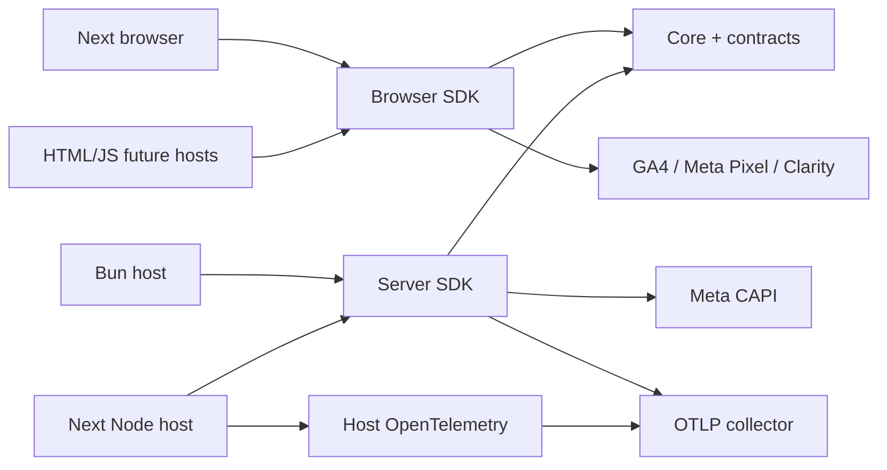

# SignalKit architecture

Implementation baseline, 2026-10-05, under the founder's explicit end-to-end build authorization. Upstream agreed scope: [PRD](PRD.md). Engineering decisions remain identifiable below; this document does not imply separate product-owner approval of every detail.

## Hosts and ownership

SignalKit ships embeddable libraries, no hosted service. Two independently runnable local consumer hosts: Next.js lab and Bun API/payment fixture. This is an explicit scope exception to a full application bootstrap: no empty standalone API/dashboard/database deployment. Hosts own identity, payment verification, storage, consent, retries, configuration and deployment.

| Package                   | Consumer           | Responsibility                                        |
| ------------------------- | ------------------ | ----------------------------------------------------- |
| @techinject/contracts     | all                | independent Zod schemas and DTOs                      |
| @techinject/core          | adapters           | consent, validation, dispatch, IDs, safe routes       |
| @techinject/browser       | browser/HTML hosts | pages, fetch/XHR, public providers, standalone bundle |
| @techinject/server        | Node/Bun hosts     | request wrapper, outbound fetch, CAPI, OTLP           |
| @techinject/nextjs        | Next browser       | root React provider/useSignals                        |
| @techinject/nextjs-server | Next Node          | host OTel registration and safe error hook            |
| @techinject/bun           | Bun                | Bun.serve fallback and route-table wrappers           |

Packages are one portable signals feature family, with framework dependencies confined to adapters. Core imports contracts only; contracts imports Zod only. Client and server Next packages are separate dependency graphs. Consumers import public exports; ESM builds and declarations belong each leaf. No process.env reads in SDK core/adapters: hosts inject config. Bun demo alone owns SQLite fixture persistence; production persistence is not an SDK feature.

## Trust and data boundaries

Browser receives public IDs only. CAPI access token, OTLP headers, webhook secret and order database remain server-only. Raw bodies/headers/error messages never become telemetry. Routes sanitized; configure explicit templates for sensitive arbitrary slugs. Third-party scripts need host privacy/masking settings. No identity API or automatic matching data extraction.

Contracts include the original ecommerce events and review-extension lead, contact, account, search and custom events. Unknown event properties are stripped; contact events accept a non-identifying channel, not a phone number or destination. Shared core URL sanitation removes query strings, fragments and credentials from provider URL metadata. The standalone browser bundle is experimental and starts denied by default; hosts connect their consent banner through `window.signals.setConsent(...)`. Bun route-table handlers are instrumented only when the host passes its table through `instrumentBunRoutes`.

Marketing uses event IDs for business duplication; traces link technical requests only. Host verified order plus durable outbox decide purchase. Demo unique order outbox prevents repeated business-event creation, while retries remain at least once with stable IDs; distributed exactly-once delivery is not promised.

## Runtime and rollout

Initial verified fixture targets Node22, Next version recorded in compatibility, Bun1.3.4. Browser needs modern fetch, crypto.randomUUID, structuredClone; older browsers need host polyfills. No Edge/native Python/PHP promise. SSR imports safe; browser start is client-only. Structural React config is init-only: remount to change provider/observer config, update consent through config or setConsent.

Next automatic incoming spans use @vercel/otel through instrumentation.ts. Enable host technical telemetry deliberately under its own lawful processing policy, configure collector redaction, avoid competing global tracer registrations. SignalKit business/browser consent does not control an independently registered global OTel provider. Optional SigNoz collector accepts OTLP; its hosting/auth/residency is host-owned.

Build graph and import boundary checks belong [maintenance](MAINTAINING.md). Demo is noindex, semantic and locally rendered, with [visual foundation](DESIGN_SYSTEM.md). Remove provider registration/root wrapper to roll back; dispose restores owned browser patches. SDK upgrades require tests against every claimed runtime.

Behavior: [FRD](frd/signals.md). Algorithms/contracts and host wiring: [feature design](../packages/features/signals/DESIGN.md), [integration guide](../packages/features/signals/INTEGRATION.md).

## Public website host — 2026-10-06

apps/site is a separate static build/runtime boundary authorized for organic discovery. Plain HTML/CSS generated by Node; no client JS, framework dependency, SDK package compilation or API. Four page routes (overview/docs/integrations/FAQ), sitemap/robots, accurate JSONLD and social previews. SITE_URL is the sole build URL input and preserves custom-domain/root or GitHub Pages/subpath URLs. Complete dist output deploys to any static host. Public content indexable; existing local labs stay noindex. Visual/content/search behavior: docs/frd/public-site.md and docs/PUBLIC-SITE.md.

## SvelteKit adapter extension

Owner-authorized addition, 12 October 2026: separate SSR-safe browser lifecycle and Node server-hook packages, plus a SvelteKit 3/Svelte 5 consumer lab. Browser mount/dispose retains consent/page/request semantics. Server handle/handleFetch uses route templates, isolated per-request config and framework fetch transport. Preserve responses, errors and browser/server import boundaries; no new hosted application or provider support. Node only; Kit 2/Edge remain unverified. Acceptance: leaf tests, independent package exports, browser boundary, real production SSR/navigation/consent/API trace checks.

## Host connections dashboard — 12 October 2026

Owner requested a simple dashboard inside each consuming app. Reuse the existing SDK instance: core exposes copied connection snapshots and isolated subscriptions; an optional browser/dashboard subpath renders them without polling or provider probes. Show event-provider configuration, current consent, bounded aggregate counters, latest SDK outcome and time. Never retain payloads, event IDs, raw errors, endpoints or credentials. Configuration is not connectivity; completed sends do not prove delivery or attribution. Counts are per instance, in memory; technical Observer status and cross-request/server aggregation are outside this first version. The host owns authentication and any server-to-browser snapshot endpoint. Next lab includes a noindex /connections consumer page. Verify failure/timeout/denial, duplicate names, mutation isolation, cleanup, safe rendering and real mobile navigation.

## Observability backend adapters — 13 October 2026

One createOTLPObserver implementation supports local and cloud SigNoz, Grafana Cloud and self-hosted Tempo/OTLP collectors. Hosts inject the full trace ingestion URL and optional authentication headers; the SDK does not infer a region, append paths or switch implementations by hosting model. Grafana's dashboard URL is not a trace ingestion endpoint.

Sentry uses a small host-injected SDK client interface in @techinject/server. SignalKit does not initialize or replace global Sentry/OTel providers. A composite Observer fans out records and lifecycle operations with failure isolation. Serverless hosts keep exports within their invocation lifecycle. Native Sentry enrichment, source maps and automatic capture remain host-owned.

## Local connections observability catalog — 13 October 2026

Owner requested visibility of the new integrations on the local /connections page. The portable dashboard accepts optional host-declared observability metadata and renders Sentry, Grafana and SigNoz separately from event-provider outcomes. Next.js and SvelteKit labs list these as not configured because their observers are synthetic. Backend labels and setup guidance are fixed, while configuration/policy flags are supplied by the host. No credentials, endpoints, provider objects, health probes or invented delivery counters are exposed. Existing two-argument dashboard calls remain supported. Configuration is unverified host information, not evidence of a connection.
