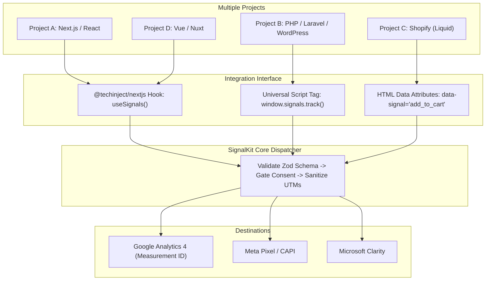

# SignalKit: Codebase Audit, Telemetry Specs & Funnel Execution Plan

A detailed technical audit of the current `signal-kit` repository, gap analysis, exact code modifications required, deep-dive into Google Tags, GA4, UTM attribution, and cross-framework hybrid management.

---

## 1. Codebase Audit: (Current Working State)

The workspace is an enterprise-grade Turborepo monorepo with 13 packages and 21 passing automated tests (`pnpm test`).

```
signal-kit/
├── packages/features/signals/
│   ├── contracts/          ──> [DONE] Zod schemas for all ecommerce events
│   ├── core/               ──> [DONE] Event dispatcher, sanitization, IDs
│   ├── browser/            ──> [DONE] GA4, Meta Pixel, Clarity, SPA routing
│   ├── nextjs/             ──> [DONE] React provider & useSignals hook
│   ├── nextjs-server/      ──> [DONE] Node OTel instrumentation
│   ├── bun/                ──> [DONE] Bun HTTP fetch instrumentation
│   ├── server/             ──> [DONE] Server signal dispatcher & OTLP observer
│   ├── sveltekit/          ──> [DONE] SvelteKit 3/5 browser client
│   └── sveltekit-server/   ──> [DONE] SvelteKit server hooks
└── examples/
    ├── nextjs/             ──> [PARTIAL] Local lab with catalog & /connections
    └── bun/                ──> [DONE] API fixture with SQLite verified purchase
```

### Deep Audit of Key Modules

#### A. `@techinject/contracts` ([contracts/src/index.ts](../packages/features/signals/contracts/src/index.ts))

- **Event Types Defined:** `page_view`, `product_view`, `add_to_cart`, `begin_checkout`, `purchase`, `search`, `generate_lead`, `custom_event`.
- **Validation:** Strict runtime parsing using Zod Mini (`text`, `amount`, `currency`, `item`, `commerce`).
- **Consent Model:** Fully typed `Consent: { analytics: boolean; marketing: boolean; observability: boolean }`. Starts frozen in `DENIED_CONSENT` mode to satisfy GDPR / privacy mandates.

#### B. `@techinject/core` ([core/src/index.ts](../packages/features/signals/core/src/index.ts))

- **Safe Routing (`safeRoute`):** Strips private query parameters, access tokens, and sensitive route segments before sending URLs to external analytics.
- **Deterministic Event IDs (`generateId`):** Generates collision-resistant IDs (`sig_...`) for Meta Pixel $\leftrightarrow$ CAPI and GA4 deduplication.
- **Dispatch Pipeline:** Validates payloads, filters by user consent, and dispatches concurrently to all authorized providers with a bounded 5-second deadline.

#### C. `@techinject/browser` ([browser/src/providers.ts](../packages/features/signals/browser/src/providers.ts))

- **GA4 Provider (`createGA4Provider`):**
  - Dynamically injects `https://www.googletagmanager.com/gtag/js?id=G-XXXXX`.
  - Sets default Google Consent Mode: `analytics_storage: 'denied'`, `ad_storage: 'denied'`, etc.
  - Automatically updates consent to `granted` when user approves.
  - Automatically maps `product_view` $\rightarrow$ GA4 `view_item`.
  - Forwards `add_to_cart`, `begin_checkout`, and `purchase` with full `items` array, `currency`, and `value`.
- **Traffic Attribution Extraction:**
  - Extracts and preserves: `utm_source`, `utm_medium`, `utm_campaign`, `utm_term`, `utm_content`, `utm_id`.
  - Extracts Click IDs: `gclid` (Google Ads), `fbclid` (Meta Ads), `dclid`, `msclkid` (Bing), `ttclid` (TikTok), `wbraid`/`gbraid` (iOS Google Ads).
  - Sanitizes `document.referrer` and strips sensitive query parameters.
- **Meta Pixel Provider (`createMetaPixelProvider`):**
  - Injects `fbevents.js`.
  - Maps SignalKit events to Meta standard events: `PageView`, `ViewContent`, `AddToCart`, `InitiateCheckout`, `Purchase`.
  - Passes matching `eventID` for server deduplication.
- **Microsoft Clarity Provider (`createClarityProvider`):**
  - Injects `https://www.clarity.ms/tag/...`.
  - Triggers named events for session recording and heatmap milestone tracking.
- **SPA Navigation & Route Interception ([browser/src/index.ts](../packages/features/signals/browser/src/index.ts#L84-L100)):**
  - Monkey-patches `window.history.pushState` and `window.history.replaceState`.
  - Listens to `popstate` and `hashchange`.
  - Fires automatic `page_view` whenever the route changes without full page reload.

---

## 2. Gap Analysis: (What Needs to Be Done)

While the engine is complete, there are **5 critical gaps** preventing this from being deployed across all client projects tomorrow:

| Gap #     | Missing Component                                          | Impact                                                                                                                                     | Solution to Build                                                                                     |
| :-------- | :--------------------------------------------------------- | :----------------------------------------------------------------------------------------------------------------------------------------- | :---------------------------------------------------------------------------------------------------- |
| **Gap 1** | **Incomplete Funnel Demo**                                 | `examples/nextjs` only has an "Add to Cart" button. It lacks `product_view` on mount, a Checkout page, and a Purchase confirmation screen. | Add a complete 4-step interactive flow in the demo store.                                             |
| **Gap 2** | **Mock Provider in Demo**                                  | `examples/nextjs/app/shell.tsx` uses a local mock recorder instead of live GA4.                                                            | Connect `createGA4Provider` using `NEXT_PUBLIC_GA4_ID` so events hit live GA4 DebugView.              |
| **Gap 3** | **No Standalone IIFE / UMD Script for Non-React Projects** | PHP, Shopify, WordPress, and Vanilla HTML cannot use npm `@techinject/nextjs`. They need a single `<script src="signalkit.bundle.js">`.    | Build an IIFE bundle exposing `window.signals` and auto-initializing from `<script>` data attributes. |
| **Gap 4** | **No Zero-Code Declarative HTML Listener**                 | Devs currently have to write JavaScript `signals.track(...)` on every button.                                                              | Add a DOM event delegation listener in the browser SDK for `data-signal="add_to_cart"`.               |
| **Gap 5** | **GA4 Dashboard Funnel Setup**                             | GA4 receives events, but reports must be configured in the GA4 UI.                                                                         | Document the exact click-by-click instructions for GA4 Funnel Exploration.                            |

---

## 3. Exact Code Changes Needed (Step-by-Step Implementation)

### Change 1: Build the Complete 4-Step E-Commerce Funnel in `examples/nextjs`

Currently, [`examples/nextjs/app/catalog/page.tsx`](../examples/nextjs/app/catalog/page.tsx) only has:

```tsx
track({ name: 'add_to_cart', properties: { ... } });
```

We need to expand the demo to include all 4 steps:

1. **Step 1 (Product View):** Trigger `product_view` when the catalog component mounts:
   ```tsx
   useEffect(() => {
     void track({
       name: 'product_view',
       properties: {
         currency: 'INR',
         value: 450,
         items: [{ item_id: 'notebook', item_name: 'Field Notebook', price: 450, quantity: 1 }],
       },
     });
   }, []);
   ```
2. **Step 2 (Add to Cart):** Button click triggers `add_to_cart` and increments cart count.
3. **Step 3 (Begin Checkout):** "Proceed to Checkout" button triggers `begin_checkout`:
   ```tsx
   void track({
     name: 'begin_checkout',
     properties: {
       currency: 'INR',
       value: 450 * cartCount,
       items: [
         { item_id: 'notebook', item_name: 'Field Notebook', price: 450, quantity: cartCount },
       ],
     },
   });
   ```
4. **Step 4 (Purchase Confirmation):** "Place Order" button triggers `purchase` with a unique transaction ID:
   ```tsx
   void track({
     name: 'purchase',
     properties: {
       transaction_id: `ORD_${Date.now()}`,
       currency: 'INR',
       value: 450 * cartCount,
       items: [
         { item_id: 'notebook', item_name: 'Field Notebook', price: 450, quantity: cartCount },
       ],
     },
   });
   ```

### Change 2: Connect Live GA4 in `examples/nextjs/app/shell.tsx`

Replace the demo's local mock with live providers when `NEXT_PUBLIC_GA4_ID` is present:

```tsx
import {
  createGA4Provider,
  createMetaPixelProvider,
  createClarityProvider,
} from '@techinject/nextjs';

const ga4Id = process.env.NEXT_PUBLIC_GA4_ID;
const metaId = process.env.NEXT_PUBLIC_META_PIXEL_ID;
const clarityId = process.env.NEXT_PUBLIC_CLARITY_ID;

const providers = [
  ...(ga4Id ? [createGA4Provider({ measurementId: ga4Id })] : []),
  ...(metaId ? [createMetaPixelProvider({ pixelId: metaId })] : []),
  ...(clarityId ? [createClarityProvider({ projectId: clarityId })] : []),
];
```

### Change 3: Build the Universal Standalone Bundle (`signalkit.bundle.js`)

Update [`scripts/build-cdn.mjs`](../scripts/build-cdn.mjs) to produce both an ESM module and a browser IIFE bundle:

```javascript
// Standalone IIFE bundle for plain HTML, PHP, Shopify, WordPress
await build({
  entryPoints: ['packages/features/signals/browser/src/standalone.ts'],
  outfile: 'packages/features/signals/browser/dist/cdn/signalkit.bundle.js',
  bundle: true,
  minify: true,
  format: 'iife',
  globalName: 'SignalKit',
  platform: 'browser',
  target: 'es2020',
});
```

---

## 4. Google Tags (`gtag.js` / GTM) Deep Dive

### How the Script Loads Under the Hood

In [`packages/features/signals/browser/src/providers.ts`](../packages/features/signals/browser/src/providers.ts#L130-L160):

1. **Dynamic DOM Injection:**
   ```javascript
   const script = document.createElement('script');
   script.async = true;
   script.src = `https://www.googletagmanager.com/gtag/js?id=${measurementId}`;
   document.head.appendChild(script);
   ```
2. **`dataLayer` Initialization:**
   ```javascript
   window.dataLayer = window.dataLayer || [];
   function gtag() {
     dataLayer.push(arguments);
   }
   ```
3. **Default Privacy Consent (Google Consent Mode v2):**
   ```javascript
   gtag('consent', 'default', {
     analytics_storage: 'denied',
     ad_storage: 'denied',
     ad_user_data: 'denied',
     ad_personalization: 'denied',
   });
   gtag('js', new Date());
   gtag('config', measurementId, {
     send_page_view: false, // Prevents duplicate initial page views
     page_location: safePageLocation(location.href),
     page_referrer: safeReferrer(document.referrer),
   });
   ```
4. **Consent Grant:**
   When the user grants consent, SignalKit calls:
   ```javascript
   gtag('consent', 'update', { analytics_storage: 'granted' });
   ```

---

## 5. Google Analytics 4 (GA4) Standard Event Specifications

GA4's backend machine-learning models and funnel explorers require strict compliance with these schemas:

### 1. `page_view`

```javascript
gtag('event', 'page_view', {
  page_location: 'https://myshop.com/products/field-notebook',
  page_path: '/products/field-notebook',
  page_referrer: 'https://google.com/',
});
```

### 2. `view_item` (SignalKit maps `product_view` $\rightarrow$ `view_item`)

```javascript
gtag('event', 'view_item', {
  currency: 'INR',
  value: 450,
  items: [
    {
      item_id: 'notebook-01',
      item_name: 'Field Notebook',
      item_category: 'Stationery',
      item_brand: 'BrandX',
      price: 450,
      quantity: 1,
    },
  ],
});
```

### 3. `add_to_cart`

```javascript
gtag('event', 'add_to_cart', {
  currency: 'INR',
  value: 900,
  items: [
    {
      item_id: 'notebook-01',
      item_name: 'Field Notebook',
      item_category: 'Stationery',
      price: 450,
      quantity: 2,
    },
  ],
});
```

### 4. `begin_checkout`

```javascript
gtag('event', 'begin_checkout', {
  currency: 'INR',
  value: 900,
  items: [{ item_id: 'notebook-01', item_name: 'Field Notebook', price: 450, quantity: 2 }],
});
```

### 5. `purchase`

```javascript
gtag('event', 'purchase', {
  transaction_id: 'ORD_20261029_001', // MANDATORY for deduplication
  currency: 'INR',
  value: 950, // Total including shipping & tax
  tax: 50,
  shipping: 0,
  items: [{ item_id: 'notebook-01', item_name: 'Field Notebook', price: 450, quantity: 2 }],
});
```

---

## 6. Traffic Attribution & UTM Extraction Engine

GA4 automatically groups visitors into acquisition channels (**Paid Search**, **Paid Social**, **Organic Search**, **Referral**, **Direct**) based on URL parameters:

```
https://myshop.com/catalog?utm_source=facebook&utm_medium=cpc&utm_campaign=diwali_sale&fbclid=IwAR2...
```

### How SignalKit Sanitizes and Forwards Attribution:

1. **Allowed Attribution Set:**
   ```javascript
   const ALLOWED_ATTRIBUTION_PARAMS = new Set([
     'utm_source',
     'utm_medium',
     'utm_campaign',
     'utm_term',
     'utm_content',
     'utm_id',
     'gclid', // Google Ads Click ID
     'fbclid', // Meta Click ID
     'dclid', // Google Display Network Click ID
     'msclkid', // Microsoft Bing Click ID
     'ttclid', // TikTok Click ID
     'twclid', // Twitter / X Click ID
     'wbraid', // Google Ads iOS Privacy Click ID (Web-to-App)
     'gbraid', // Google Ads iOS Privacy Click ID (App-to-Web)
   ]);
   ```
2. **PII Stripping:** Any query parameter containing `@` (email addresses) or exceeding 512 characters is dropped to protect customer privacy.
3. **Safe Referrer:** Strips internal search queries and session IDs from `document.referrer`.
4. **GA4 Classification Result:**
   - If `gclid` is present $\rightarrow$ Channel: **Paid Search (Google Ads)**.
   - If `fbclid` or `utm_source=facebook` + `utm_medium=cpc` $\rightarrow$ Channel: **Paid Social (Meta Ads)**.
   - If `document.referrer` is `google.com` (no UTMs) $\rightarrow$ Channel: **Organic Search**.
   - If no referrer and no UTMs $\rightarrow$ Channel: **Direct**.

---

## 7. Multi-Framework & Hybrid Tech Management

To handle different projects running different technologies without rewriting code:



### Implementation Matrix by Technology:

| Technology                  | Integration Method      | Code Sample                                                                        |
| :-------------------------- | :---------------------- | :--------------------------------------------------------------------------------- |
| **Next.js (App Router)**    | `@techinject/nextjs`    | `<SignalKitProvider config={...}>` in `app/layout.tsx`                             |
| **React (Vite / CRA)**      | `@techinject/browser`   | `const signals = createBrowserSignals({...})` in `main.tsx`                        |
| **Vue 3 / Nuxt**            | Universal script or ESM | `app.provide('signals', createBrowserSignals({...}))`                              |
| **PHP / Laravel**           | Single `<script>` tag   | `<script src="/signalkit.bundle.js" data-ga4="G-XXX"></script>` in `app.blade.php` |
| **Shopify**                 | Theme Liquid template   | Paste bundle in `theme.liquid` + `data-signal="add_to_cart"` on product forms      |
| **WordPress / WooCommerce** | Custom script / plugin  | Enqueue `signalkit.bundle.js` in `header.php`                                      |

### Declarative Zero-Code HTML (`data-signal`):

For any HTML/CSS button where developers do not want to write JavaScript:

```html
<button
  type="button"
  class="btn-cart"
  data-signal="add_to_cart"
  data-item-id="ITEM-101"
  data-item-name="Field Notebook"
  data-price="450"
  data-currency="INR"
>
  Add to Cart
</button>
```

---

## 8. Step-by-Step Action Plan:

### Phase 1: Local Code Updates

1. In `examples/nextjs/app/catalog/page.tsx`:
   - Add `product_view` on component mount.
   - Add a "Checkout" button firing `begin_checkout`.
   - Add a "Confirm Purchase" button firing `purchase`.
2. In `examples/nextjs/app/shell.tsx`:
   - Replace mock provider with `createGA4Provider` using `process.env.NEXT_PUBLIC_GA4_ID`.

### Phase 2: Live Verification in Google Analytics

1. Run local lab:
   ```bash
   export NEXT_PUBLIC_GA4_ID="G-XXXXXXXXXX"
   pnpm --filter @signalkit/example-nextjs dev
   ```
2. Open `http://localhost:3100/catalog?utm_source=google_ads&utm_medium=cpc&utm_campaign=test_funnel` in Chrome.
3. Open **GA4 $\rightarrow$ Admin $\rightarrow$ DebugView**.
4. Click through the funnel:
   - View Notebook $\rightarrow$ `view_item` appears in DebugView.
   - Click "Add to Cart" $\rightarrow$ `add_to_cart` appears.
   - Click "Proceed to Checkout" $\rightarrow$ `begin_checkout` appears.
   - Click "Place Order" $\rightarrow$ `purchase` appears.

### Phase 3: GA4 Funnel Report Setup

1. In GA4, go to **Explore** $\rightarrow$ Click **Funnel Exploration**.
2. Set steps:
   - Step 1: `view_item`
   - Step 2: `add_to_cart`
   - Step 3: `begin_checkout`
   - Step 4: `purchase`
3. In **Breakdown**, select **Session source / medium**.
4. Take a screenshot of the completed funnel showing drop-off percentages and attribution.
