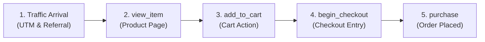

# E-Commerce Telemetry & Funnel Architecture Roadmap

A comprehensive, production-grade guide for implementing multi-platform e-commerce funnels, Google Tag Manager / Google Tags (`gtag.js`), Google Analytics 4 (GA4), Meta Pixel, and Microsoft Clarity across hybrid technologies.

---

## 1. Executive Summary & Core Objective

### What We Are Building

A **Universal Funnel Tracking Architecture** embedded inside `signal-kit` that captures:

1. **Traffic Attribution:** Where did the user arrive from? (Google Ads, Meta Ads, organic search, referral, or direct).
2. **Navigation & Routes:** Which pages, routes, and URLs did the user visit (SPA soft routes, hybrid navigation, and MPA hard loads)?
3. **Product Catalog Engagement:** Which items were viewed (`product_view` $\rightarrow$ GA4 `view_item`)?
4. **Cart Actions:** Which items were added to the cart, with what price and quantity (`add_to_cart`)?
5. **Checkout Drop-off:** How many times did the user reach checkout (`begin_checkout`) and at what steps did they abandon?
6. **Conversion / Purchase:** Final order confirmation (`purchase`), transaction ID, and revenue.

### The Hybrid Tech Challenge

Projects differ in tech stack:

- **SPAs:** Next.js, React, Vue, SvelteKit, Angular.
- **Server-Rendered / MPAs:** PHP (Laravel, CodeIgniter), Python (Django), WordPress/WooCommerce.
- **E-commerce CMS:** Shopify (Liquid), Magento, Custom HTML/CSS/JS.

**The Architectural Solution:** A **two-tier telemetry architecture**:

- **Layer 1 (Core Engine):** A platform-independent browser engine (`window.signals`) and declarative HTML `data-*` listeners that run identically in any browser regardless of framework.
- **Layer 2 (Framework Adapters):** Dedicated wrappers (`useSignals()` for Next.js/React, server hooks for Bun/Node/PHP) for native developer experience.

---

## 2. Prerequisites & Credentials Checklist

Before writing code or configuring funnels, the following accounts and IDs are required per project:

| Platform                            | Required Identifier | Format / Example                 | Where to Find in Admin UI                                                       |
| :---------------------------------- | :------------------ | :------------------------------- | :------------------------------------------------------------------------------ |
| **Google Analytics 4**              | GA4 Measurement ID  | `G-XXXXXXXXXX`                   | Admin $\rightarrow$ Data Streams $\rightarrow$ Web $\rightarrow$ Measurement ID |
| **Google Tag Manager** _(Optional)_ | GTM Container ID    | `GTM-XXXXXXX`                    | GTM Dashboard top right                                                         |
| **Meta Pixel**                      | Pixel ID            | `123456789012345` (15-16 digits) | Meta Events Manager $\rightarrow$ Data Sources $\rightarrow$ Settings           |
| **Microsoft Clarity**               | Clarity Project ID  | `a1b2c3d4e5` (alphanumeric)      | Clarity Dashboard $\rightarrow$ Settings $\rightarrow$ Overview                 |

> [!IMPORTANT]
> **Never hardcode secrets**: Measurement IDs and Pixel IDs are public client identifiers. Do **not** expose private API tokens (like Meta CAPI Access Tokens or Google Service Account keys) in client-side code.

---

## 3. Google Tag (`gtag.js`) vs. Google Tag Manager (GTM) vs. GA4

Understanding how these three tools connect prevents architectural mistakes:

```
[ User Action: Click "Add to Cart" ]
                │
                ▼
      [ SignalKit Core ] ─── window.signals.track('add_to_cart', payload)
                │
                ├─────────────────────────────────────────────┐
                ▼                                             ▼
   [ Option 1: Direct Google Tag ]             [ Option 2: GTM DataLayer ]
       gtag('event', 'add_to_cart')                dataLayer.push({ event: 'add_to_cart' })
                │                                             │
                ▼                                             ▼
     [ Google Analytics 4 ]                      [ GTM Container Rules ]
     (Processes ecommerce events,                             │
      computes conversion rates,                              ▼
      generates funnel reports)                    [ GA4 / Meta / Ads Tags ]
```

### Which One Should You Use?

1. **Direct Google Tag (`gtag.js`) via SignalKit (Recommended for this SDK):**
   - SignalKit already has `createGA4Provider` built-in.
   - It directly initializes `gtag.js` and fires standard GA4 events (`view_item`, `add_to_cart`, `begin_checkout`, `purchase`).
   - Fastest loading, zero GTM container latency, fully typed with Zod contracts.
2. **Google Tag Manager (GTM):**
   - Use GTM if non-technical marketing teams need to add tracking scripts without deploying code.
   - SignalKit can push events to `window.dataLayer` if GTM is present.

---

## 4. The 5-Step E-Commerce Funnel Specification

Google Analytics 4 expects strict standard event names and item parameters to auto-generate funnel reports.



### Event Payloads & Mapping Table

| Step                   | SignalKit Event  | GA4 Mapped Event | Meta Pixel Mapped  | Microsoft Clarity       | Mandatory Parameters                                           |
| :--------------------- | :--------------- | :--------------- | :----------------- | :---------------------- | :------------------------------------------------------------- |
| **0. Page Navigation** | `page_view`      | `page_view`      | `PageView`         | Auto page               | `page_path`                                                    |
| **1. Product View**    | `product_view`   | `view_item`      | `ViewContent`      | `event: product_view`   | `currency`, `value`, `items` (`item_id`, `item_name`, `price`) |
| **2. Add to Cart**     | `add_to_cart`    | `add_to_cart`    | `AddToCart`        | `event: add_to_cart`    | `currency`, `value`, `items` (`item_id`, `quantity`, `price`)  |
| **3. Begin Checkout**  | `begin_checkout` | `begin_checkout` | `InitiateCheckout` | `event: begin_checkout` | `currency`, `value`, `items`                                   |
| **4. Purchase**        | `purchase`       | `purchase`       | `Purchase`         | `event: purchase`       | `transaction_id`, `currency`, `value`, `items`                 |

---

## 5. Traffic Attribution Tracking (Where Did the User Arrive From?)

When users click Google Ads, Meta Ads, or external links, URL parameters and headers carry attribution data.

### How SignalKit Captures Attribution

Inside `packages/features/signals/browser/src/providers.ts`:

1. **Safe Location & Query Filter:** SignalKit extracts and preserves only authorized advertising parameters:
   - `utm_source` (e.g. `google`, `facebook`, `newsletter`)
   - `utm_medium` (e.g. `cpc`, `banner`, `email`)
   - `utm_campaign` (e.g. `diwali_sale`, `summer_2026`)
   - `utm_term`, `utm_content`, `utm_id`
   - `gclid` (Google Click Identifier for Google Ads)
   - `fbclid` (Facebook Click Identifier for Meta Ads)
   - `ttclid` (TikTok Click Identifier)
2. **Safe Referrer Extraction:** Sanitizes `document.referrer` to retain domain and origin while stripping sensitive tokens.
3. **GA4 Forwarding:** Attaches `page_location` and `page_referrer` to every dispatch. GA4 automatically classifies traffic into:
   - **Paid Search** (`gclid` or `utm_medium=cpc`)
   - **Paid Social** (`fbclid` or `utm_source=facebook&utm_medium=cpc`)
   - **Organic Search** (`referrer=google.com`)
   - **Direct** (empty referrer and no query params)

---

## 6. Hybrid & Cross-Technology Implementation Architecture

To ensure the funnel runs consistently across any project regardless of technology stack, implement the three tiers below:

### Tier 1: Modern React / Next.js Projects

Uses the `@techinject/nextjs` package with typed hooks.

```tsx
// app/providers.tsx
'use client';
import {
  SignalKitProvider,
  createGA4Provider,
  createMetaPixelProvider,
  createClarityProvider,
} from '@techinject/nextjs';

const config = {
  providers: [
    createGA4Provider({ measurementId: process.env.NEXT_PUBLIC_GA4_ID! }),
    createMetaPixelProvider({ pixelId: process.env.NEXT_PUBLIC_META_PIXEL_ID! }),
    createClarityProvider({ projectId: process.env.NEXT_PUBLIC_CLARITY_ID! }),
  ],
  consent: { analytics: true, marketing: true, observability: true },
};

export function TelemetryProvider({ children }: { children: React.ReactNode }) {
  return <SignalKitProvider config={config}>{children}</SignalKitProvider>;
}
```

Triggering in UI:

```tsx
import { useSignals } from '@techinject/nextjs';

export function AddToCartButton({ product }) {
  const signals = useSignals();

  return (
    <button
      onClick={() => {
        signals.track({
          name: 'add_to_cart',
          properties: {
            currency: 'INR',
            value: product.price,
            items: [
              { item_id: product.id, item_name: product.name, price: product.price, quantity: 1 },
            ],
          },
        });
      }}
    >
      Add to Cart
    </button>
  );
}
```

---

### Tier 2: Universal Vanilla JS / HTML / PHP / Shopify Projects

For projects using server-rendered HTML (PHP, Laravel, Django), CMS (Shopify, WordPress), or legacy jQuery/vanilla JS.

#### Step 1: Include the Universal Bundle in `<head>`

```html
<script
  src="/assets/signalkit.bundle.js"
  data-ga4-id="G-XXXXXXXXXX"
  data-meta-id="123456789012345"
  data-clarity-id="a1b2c3d4e5"
></script>
```

Consent is denied for all categories until the host banner applies the visitor's actual choices to the standalone SDK:

```js
window.signals.setConsent({
  analytics: visitorChoice.analytics === true,
  marketing: visitorChoice.marketing === true,
  observability: visitorChoice.observability === true,
});
```

Call this from the banner after the visitor chooses, or when restoring a previously saved choice. Events recorded before consent are dropped and are not replayed.

#### Step 2: Trigger Events via `window.signals.track`

```html
<script>
  function handleCartAdd(product) {
    window.signals.track({
      name: 'add_to_cart',
      properties: {
        currency: 'INR',
        value: product.price,
        items: [
          {
            item_id: product.id,
            item_name: product.name,
            price: product.price,
            quantity: 1,
          },
        ],
      },
    });
  }
</script>
```

---

### Tier 3: Zero-Code Declarative HTML Data Attributes

For marketing pages, hybrid CSS layouts, or projects where modifying JavaScript is restricted:

Add a DOM-delegation listener in the SDK bundle:

```javascript
// Auto-listener for data attributes across any technology
document.addEventListener('click', (event) => {
  const target = event.target.closest('[data-signal]');
  if (!target) return;

  const eventName = target.getAttribute('data-signal');
  if (eventName === 'add_to_cart' || eventName === 'begin_checkout') {
    const itemId = target.getAttribute('data-item-id');
    const itemName = target.getAttribute('data-item-name');
    const price = parseFloat(target.getAttribute('data-price') || '0');
    const currency = target.getAttribute('data-currency') || 'INR';

    window.signals.track({
      name: eventName,
      properties: {
        currency,
        value: price,
        items: [{ item_id: itemId, item_name: itemName, price, quantity: 1 }],
      },
    });
  }
});
```

Usage in any HTML/CSS button:

```html
<button
  class="btn btn-primary"
  data-signal="add_to_cart"
  data-item-id="SHOES-99"
  data-item-name="Running Shoes"
  data-price="2499"
  data-currency="INR"
  data-quantity="1"
>
  Add to Cart
</button>
```

---

## 7. SPA vs. Hybrid Navigation Handling

Single-page applications (Next.js App Router, Vue Router, React Router) do not trigger full browser reloads when navigating between routes.

SignalKit automatically patches:

- `window.history.pushState`
- `window.history.replaceState`
- `window.addEventListener('popstate', ...)`
- `window.addEventListener('hashchange', ...)` when `trackHash: true` is configured for a `#/` or `#!/` router

Whenever the URL path changes, SignalKit emits a sanitized `page_view` event.

> [!NOTE]
> To avoid duplicate page views in GA4, turn **OFF** "Page changes based on browser history events" inside **GA4 $\rightarrow$ Admin $\rightarrow$ Data Streams $\rightarrow$ Enhanced Measurement settings**, since SignalKit explicitly controls route dispatches.

---

## 8. How to Configure & View Funnels in Google Analytics 4 (GA4)

Once events are flowing into GA4, configure the funnel reports:

### Method 1: Built-in "Purchase Journey" Report (Instant)

1. Navigate to **Reports $\rightarrow$ Monetization $\rightarrow$ Purchase journey**.
2. GA4 will automatically render a bar chart of:
   $$\text{Session start} \longrightarrow \text{view\_item} \longrightarrow \text{add\_to\_cart} \longrightarrow \text{begin\_checkout} \longrightarrow \text{purchase}$$
3. Drop-off rates between each stage are calculated automatically.

### Method 2: Custom Funnel Exploration (Detailed Breakdown)

To view drop-offs broken down by **Traffic Source (Ads vs Organic)**:

1. Open GA4 $\rightarrow$ **Explore** $\rightarrow$ Click **Funnel exploration**.
2. In the **Steps** configuration, click the pencil edit icon:
   - **Step 1: Product View** $\rightarrow$ Event name = `view_item`
   - **Step 2: Cart Add** $\rightarrow$ Event name = `add_to_cart`
   - **Step 3: Checkout Initiated** $\rightarrow$ Event name = `begin_checkout`
   - **Step 4: Order Success** $\rightarrow$ Event name = `purchase`
3. In **Breakdown**, drag and drop **Session source / medium** or **First user campaign**.
4. **Outcome:** The visual funnel separates into comparative columns (e.g., _Google Ads conversion rate: 4.2%_ vs. _Instagram Ads conversion rate: 1.1%_).

### Method 3: User Journey Path Exploration

To see where users went before and after checkout:

1. Navigate to **Explore $\rightarrow$ Path exploration**.
2. Set the starting point or ending point to `Event name` = `begin_checkout`.
3. View the tree diagram showing exact predecessor and successor pages.

---

## 9. Critical Edge Cases & Implementation Guardrails

### 1. Purchase Reliability (Server-Side vs. Client-Side)

- **Problem:** A client button or success page cannot prove payment and can emit a false `purchase`.
- **Solution:** Verify purchases via server webhook (e.g., Razorpay/Stripe webhook) and emit `purchase` only from verified server state, with a stable `eventId` and `transaction_id`.

### 2. Event Deduplication

- When both client and server send events to Meta Pixel / CAPI, send an identical `eventId`. Meta deduplicates records sharing the same `eventID` received within 48 hours.

### 3. Consent Management (GDPR / Google Consent Mode v2)

- SignalKit starts in `DENIED_CONSENT` mode by default.
- Once user accepts cookie/analytics consent on the website:
  ```ts
  signals.setConsent({ analytics: true, marketing: true, observability: true });
  ```
- This dynamically updates `gtag('consent', 'update', { analytics_storage: 'granted' })` and enables Meta Pixel.

---

## 10. Implementation Roadmap & Timeline

| Phase                     | Task                                                                | Target Timeline   | Deliverable                       |
| :------------------------ | :------------------------------------------------------------------ | :---------------- | :-------------------------------- |
| **Phase 1: Setup**        | Collect GA4 Measurement IDs and Meta Pixel IDs per project          | Day 1 (Morning)   | Credentials list                  |
| **Phase 2: Core SDK**     | Build universal browser bundle with `data-signal` auto-listener     | Day 1 (Midday)    | `dist/signalkit.bundle.js`        |
| **Phase 3: Integration**  | Inject script / providers into target projects (Next.js & HTML/PHP) | Day 1 (Afternoon) | Root layout injection             |
| **Phase 4: Events**       | Wire client view/cart/checkout; verify server purchase              | Day 1 (Evening)   | Catalog, Cart, Checkout & webhook |
| **Phase 5: Verification** | Test via GA4 DebugView and Chrome GA Debugger extension             | Day 2 (Morning)   | Verified event stream in GA4      |
| **Phase 6: Reporting**    | Build Funnel Exploration & Path Exploration reports in GA4          | Day 2 (Midday)    | Completed visual funnels          |
